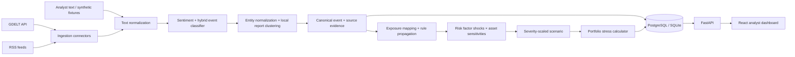

# Architecture

The prototype is a modular monolith. Connectors, analysis, portfolio math, persistence and API routes are separated in Python packages, while React consumes typed REST responses. The dashboard can run against bundled demo data without credentials. Ingestion is pull-based and manual in this build; APScheduler, queues and independent inference workers are extension points, not dependencies of the MVP.

## Signal lifecycle

1. GDELT and configured public RSS providers fetch in parallel on manual refresh; an individual failure does not block other providers. The bundled social examples are synthetic fixtures.
2. Local sentence-embedding similarity to event-type descriptions is preferred when the optional model is available. Explicit keyword rules and then token similarity provide labeled fallbacks. Classification strength is uncalibrated similarity or cue strength, not probability. FinBERT is optional for sentiment only; lexical sentiment remains the fallback.
3. Reports are clustered with local cosine similarity and a same-entity/event-class rule. Synthetic, external and analyst-submitted source families are not cross-clustered.
4. The canonical event includes distinct source names, source metadata, time bounds, normalized entities, a configurable multi-factor impact heuristic and source-confidence estimate.
5. A canonical risk-factor library maps event → factor shock → configured asset sensitivity → approximate asset return and portfolio P&L. Every shock is labeled as model-implied stress, never as a forecast.
6. The event can generate editable mild/base/severe assumptions; the what-if calculator estimates asset and portfolio P&L. Reverse stress scales a template to a requested loss threshold. Recent clusters group events only on shared configured entities, sectors or event-relevant risk factors.

The API exposes per-provider provenance and fetch state at `GET /api/sources/status`. `LIVE` is written to an article only along the successful provider-ingestion path. Synthetic fixtures remain explicitly synthetic; analyst-entered text is fallback data even if its submitted source label names a publisher.

Canonical events are currently assembled from persisted report rows at request time; high-volume deployments should persist cluster assignments and refresh them incrementally. Relationships and alias coverage are intentionally bounded and are not a learned causal graph or production entity master.

## Scaling path

At higher volumes, run the same bounded connector and inference interfaces as independent workers, enqueue normalized documents, add Redis for short-lived jobs and cache, and partition/index records by event time/entity. Keep model version and evidence lineage in every result. The hackathon edition intentionally starts with a modular monolith.
